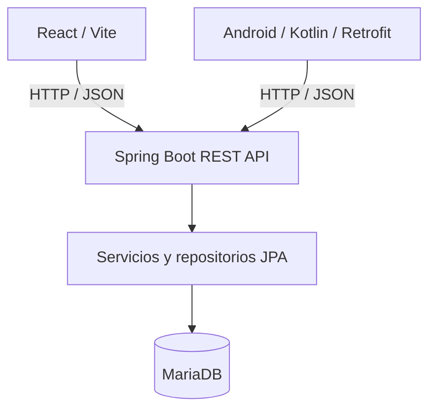
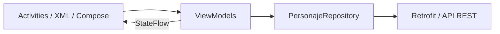
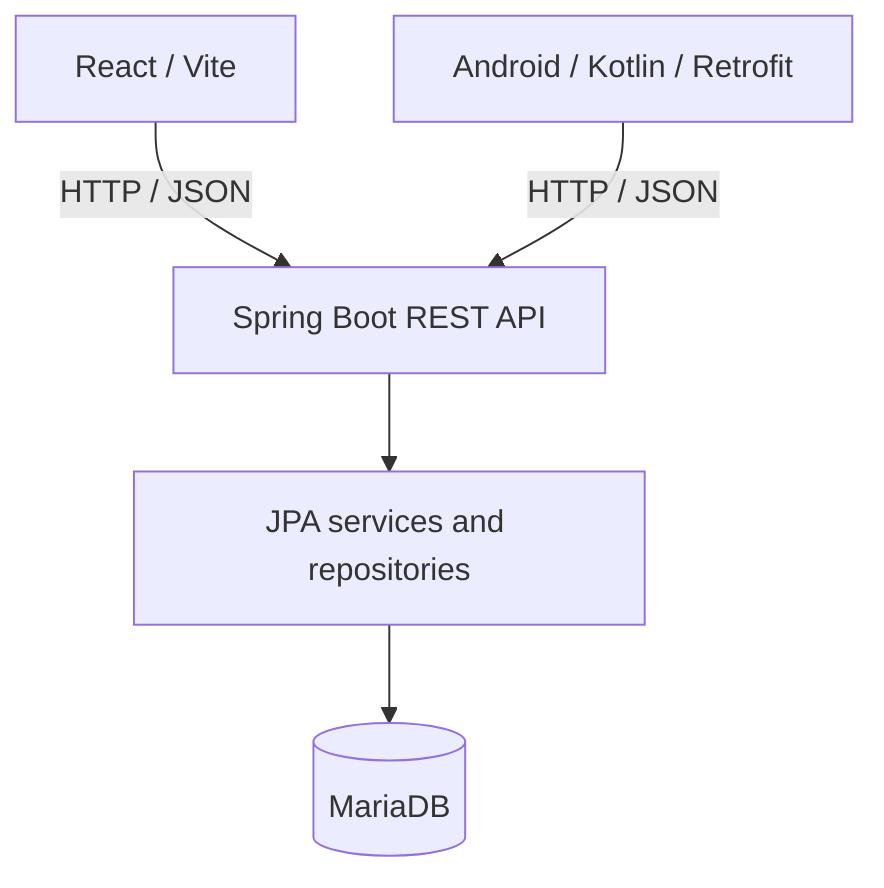
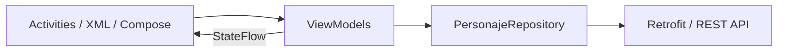

# UMBRA — Roleplaying Character Manager

<p align="center">
  <strong>Tu universo, tus personajes, tus historias.</strong><br>
  Your universe, your characters, your stories.
</p>

<!-- Añade aquí el logotipo / Add the logo here:
<p align="center"></p>
-->

<p align="center">
  
  
  
  
</p>

**Idioma / Language:** [Español](#español) · [English](#english)

<!-- Portada general / Project banner:

-->

## Español

### 1. Descripción

UMBRA es una aplicación multiplataforma para la creación, gestión y consulta de personajes de rol. Permite organizar fichas en una biblioteca personal, desarrollar historias y personalidades, definir estadísticas y controlar la visibilidad de los personajes.

El proyecto se desarrolla como parte del Proyecto Interdisciplinar de 2.º del Ciclo Formativo de Grado Superior en Desarrollo de Aplicaciones Multiplataforma (DAM), curso 2026–2027, en el IES El Rincón.

### 2. Funcionalidades

- Autenticación de usuarios y acceso a la biblioteca personal.
- Creación, consulta, edición y eliminación de personajes (CRUD).
- Gestión de nombre, historia, personalidad, clase, raza, origen, nivel y estadísticas.
- Visibilidad pública o privada y control de permisos sobre los personajes.
- Interfaz web adaptable a diferentes tamaños de pantalla, con soporte de español e inglés.
- Aplicación Android con pantallas XML Views y un formulario desarrollado con Jetpack Compose.
- Validación de formularios, gestión de estados de carga y mensajes de error.

La evolución del proyecto incluye opciones de configuración, notificaciones y funcionalidades de compartición. Su disponibilidad depende del estado de implementación de cada cliente.

### 3. Repositorios

| Componente | Tecnología | Repositorio |
| --- | --- | --- |
| Aplicación web | React, Vite | [UMBRA Web](https://github.com/Ixf2/UMBRAJoanaRamirez/tree/develop) |
| Aplicación móvil | Kotlin, Android Studio | [UMBRA Android](https://github.com/Ixf2/UMBRAAndroid/tree/develop) |
| Backend | Java, Spring Boot, Maven | [UMBRA Backend](https://github.com/Ixf2/UmbraBackendJoanaRam-rez/tree/develop) |
| Base de datos | MariaDB, SQL | Esquema `umbra` |

### 4. Arquitectura

Los clientes web y Android se comunican con una API REST compartida. Spring Boot centraliza la lógica de negocio y el acceso a la base de datos mediante Spring Data JPA e Hibernate.



En Android se utiliza MVVM para la gestión de personajes:



### 5. Tecnologías

| Área | Herramientas |
| --- | --- |
| Web | React, Vite, JavaScript, CSS, i18next |
| Android | Kotlin, XML Views, Jetpack Compose, RecyclerView, Retrofit, Coroutines, StateFlow |
| Backend | Java, Spring Boot, Maven, Spring Data JPA, Hibernate |
| Persistencia | MariaDB, SQL, ORM |
| Calidad | Android Lint, Lighthouse, validaciones y pruebas funcionales |
| Control de versiones | Git, GitHub |

### 6. Instalación y ejecución local

#### Requisitos previos

- Git, Node.js y npm.
- JDK compatible con la configuración Maven del backend.
- MariaDB y un cliente SQL.
- Android Studio, Android SDK y un emulador o dispositivo Android.

#### Base de datos

1. Crear la base de datos `umbra` en MariaDB.
2. Importar el script SQL actualizado del proyecto.
3. Configurar la conexión del backend en `application.properties` o mediante la configuración externa correspondiente. No publicar contraseñas ni credenciales reales.

#### Backend

```bash
git clone -b develop https://github.com/Ixf2/UmbraBackendJoanaRam-rez.git
cd UmbraBackendJoanaRam-rez
```

Abrir el proyecto Maven en el IDE, configurar la conexión a MariaDB y ejecutar `UmbraBackendApplication`. Si el proyecto incluye Maven Wrapper, también se puede ejecutar `./mvnw spring-boot:run` (en Windows, `.\mvnw.cmd spring-boot:run`). Con Maven instalado, utilizar `mvn spring-boot:run`.

La configuración local utilizada durante el desarrollo emplea el puerto `8080`.

#### Aplicación web

```bash
git clone -b develop https://github.com/Ixf2/UMBRAJoanaRamirez.git
cd UMBRAJoanaRamirez
npm install
npm run dev
```

Abrir la URL que muestra Vite en la terminal y comprobar que la configuración de la API apunta al backend en ejecución.

#### Aplicación Android

```bash
git clone -b develop https://github.com/Ixf2/UMBRAAndroid.git
```

1. Abrir el proyecto con Android Studio y sincronizar Gradle.
2. Iniciar el backend y MariaDB.
3. Iniciar el emulador o conectar el dispositivo mediante ADB.
4. Para la configuración local usada en el proyecto, ejecutar:

```bash
adb reverse tcp:8080 tcp:8080
```

La URL base de Retrofit en ese entorno es `http://127.0.0.1:8080/`. El comando requiere que ADB esté disponible y el dispositivo conectado. Ejecutar la aplicación desde Android Studio.

### 7. Capturas del proyecto

Guarda las imágenes en `docs/images/`, junto al README en el repositorio donde lo publiques. Elimina las marcas de comentario HTML que rodean cada imagen cuando hayas añadido el archivo correspondiente.

#### Aplicación web

<!--


-->

#### Aplicación Android

<!--
<p align="center">
  
  
  
  
</p>
-->

#### Backend y base de datos

<!--


-->

### 8. Calidad, seguridad y sostenibilidad

- Separación de responsabilidades entre interfaz, lógica y persistencia.
- Validaciones de entrada y control de acceso a operaciones sobre personajes.
- Optimización de imágenes web mediante WebP.
- Auditorías con Lighthouse y Android Lint.
- Recursos de texto Android centralizados y uso de plurales.

Las pruebas finales de integración, permisos y rendimiento forman parte de la revisión previa a la entrega. El HTTP local se utiliza para desarrollo; un despliegue público requiere HTTPS y una configuración segura de credenciales.

<!-- Evidencias de calidad / Quality evidence:


-->

### 9. Estado y autoría

Proyecto académico en desarrollo. Rama de trabajo: `develop`.

**Autora:** Joana del Pino Ramírez García — [GitHub: Ixf2](https://github.com/Ixf2).

**Formación:** 2.º DAM · IES El Rincón · 2026–2027.

---

## English

### 1. Overview

UMBRA is a cross-platform application for creating, managing and browsing roleplaying characters. Users can organise character sheets in a personal library, develop backstories and personalities, define statistics and manage character visibility.

It is developed as an interdisciplinary academic project for the second year of the Higher Vocational Training programme in Multiplatform Application Development (DAM), academic year 2026–2027, at IES El Rincón.

### 2. Features

- User authentication and access to a personal character library.
- Create, read, update and delete characters (CRUD).
- Character names, backstories, personalities, classes, races, origins, levels and statistics.
- Public or private visibility and character access permissions.
- Responsive web interface with Spanish and English language support.
- Native Android application using XML Views and a Jetpack Compose form.
- Form validation, loading states and error messages.

The project roadmap also includes settings, notifications and character-sharing features. Availability depends on the implementation status of each client.

### 3. Repositories

| Component | Technology | Repository |
| --- | --- | --- |
| Web application | React, Vite | [UMBRA Web](https://github.com/Ixf2/UMBRAJoanaRamirez/tree/develop) |
| Mobile application | Kotlin, Android Studio | [UMBRA Android](https://github.com/Ixf2/UMBRAAndroid/tree/develop) |
| Backend | Java, Spring Boot, Maven | [UMBRA Backend](https://github.com/Ixf2/UmbraBackendJoanaRam-rez/tree/develop) |
| Database | MariaDB, SQL | `umbra` schema |

### 4. Architecture

The web and Android clients communicate with a shared REST API. Spring Boot centralises business logic and database access through Spring Data JPA and Hibernate.



Android character management follows the MVVM pattern:



### 5. Technology stack

| Area | Tools |
| --- | --- |
| Web | React, Vite, JavaScript, CSS, i18next |
| Android | Kotlin, XML Views, Jetpack Compose, RecyclerView, Retrofit, Coroutines, StateFlow |
| Backend | Java, Spring Boot, Maven, Spring Data JPA, Hibernate |
| Persistence | MariaDB, SQL, ORM |
| Quality | Android Lint, Lighthouse, validation and functional testing |
| Version control | Git, GitHub |

### 6. Local installation and setup

#### Prerequisites

- Git, Node.js and npm.
- A JDK compatible with the backend Maven configuration.
- MariaDB and an SQL client.
- Android Studio, Android SDK and an emulator or Android device.

#### Database

1. Create the `umbra` database in MariaDB.
2. Import the current project SQL script.
3. Configure the backend database connection in `application.properties` or the appropriate external configuration. Never publish real passwords or credentials.

#### Backend

```bash
git clone -b develop https://github.com/Ixf2/UmbraBackendJoanaRam-rez.git
cd UmbraBackendJoanaRam-rez
```

Open the Maven project in your IDE, configure the MariaDB connection and run `UmbraBackendApplication`. If Maven Wrapper is included, use `./mvnw spring-boot:run` (Windows: `.\mvnw.cmd spring-boot:run`). Alternatively, with Maven installed, use `mvn spring-boot:run`.

The local development configuration uses port `8080`.

#### Web application

```bash
git clone -b develop https://github.com/Ixf2/UMBRAJoanaRamirez.git
cd UMBRAJoanaRamirez
npm install
npm run dev
```

Open the URL displayed by Vite and verify that the API configuration points to the running backend.

#### Android application

```bash
git clone -b develop https://github.com/Ixf2/UMBRAAndroid.git
```

1. Open the project in Android Studio and synchronise Gradle.
2. Start the backend and MariaDB.
3. Start the emulator or connect an Android device using ADB.
4. For the project's local development setup, run:

```bash
adb reverse tcp:8080 tcp:8080
```

The Retrofit base URL in this environment is `http://127.0.0.1:8080/`. ADB must be available and the device connected. Run the application from Android Studio.

### 7. Project screenshots

The screenshots are shared between both language sections. See [the screenshot gallery](#7-capturas-del-proyecto). Store the images in `docs/images/` and uncomment the image references once the files are available.

### 8. Quality, security and sustainability

- Separation of concerns between the interface, business logic and persistence.
- Input validation and access control for character operations.
- Web image optimisation using WebP.
- Lighthouse and Android Lint audits.
- Centralised Android text resources and plural handling.

Final integration, permission and performance tests are part of the pre-delivery review. Local HTTP is used for development only; public deployment requires HTTPS and secure credential configuration.

### 9. Project status and author

Academic project under development. Working branch: `develop`.

**Author:** Joana del Pino Ramírez García — [GitHub: Ixf2](https://github.com/Ixf2).

**Programme:** Second-year DAM · IES El Rincón · 2026–2027.

---

<p align="center"><strong>UMBRA</strong> · Create. Explore. Imagine.</p>
