# UMBRA — Roleplaying Character Manager

<p align="center">
  <strong>Tu universo, tus personajes, tus historias.</strong><br>
  Your universe, your characters, your stories.
</p>

<!-- Añade aquí el logotipo / Add the logo here:
<p align="center"></p>
-->

<p align="center">
  
  
  
  
</p>

**Idioma / Language:** [Español](#español) · [English](#english)

<!-- Portada general / Project banner:

-->

## Español

### 1. Descripción

UMBRA es una aplicación multiplataforma para la creación, gestión y consulta de personajes de rol. Permite organizar fichas en una biblioteca personal, desarrollar historias y personalidades, definir estadísticas y controlar la visibilidad de los personajes.

El proyecto se desarrolla como parte del Proyecto Interdisciplinar de 2.º del Ciclo Formativo de Grado Superior en Desarrollo de Aplicaciones Multiplataforma (DAM), curso 2026–2027, en el IES El Rincón.

### 2. Funcionalidades

- Registro de usuarios desde Android, con validación de nombre, correo, contraseña y confirmación de contraseña.
- Inicio y cierre de sesión mediante Spring Security; autenticación obligatoria para consultar personajes públicos o privados.
- Biblioteca personal y biblioteca pública mediante pestañas: gestión de personajes propios y consulta de personajes públicos de otros usuarios registrados.
- La pestaña pública es de solo lectura; la edición y eliminación se realizan desde la biblioteca personal y están sujetas a la autorización del servidor.
- Verificación de sesión en Android mediante `SessionManager` y protección de las Activities internas.
- Generador aleatorio de personajes en Android: nombre, clase, raza, origen, historia, personalidad, nivel, rasgos y estadísticas editables antes de guardar.
- Selección de retratos PNG, JPEG o WebP desde el dispositivo (máximo 5 MiB), vista previa y actualización del retrato.
- Miniaturas en la biblioteca y retratos de mayor resolución en la ficha; almacenamiento binario WebP en MariaDB.
- Creación, consulta, edición y eliminación de personajes (CRUD).
- Gestión de nombre, historia, personalidad, clase, raza, origen, nivel y estadísticas.
- Visibilidad pública o privada y control de permisos sobre los personajes.
- Interfaz web adaptable a diferentes tamaños de pantalla, con soporte de español e inglés.
- Aplicación Android con cinco Activities: cuatro con XML Views y una con Jetpack Compose.
- Validación de formularios, gestión de estados de carga y mensajes de error.

La evolución del proyecto incluye opciones de configuración, notificaciones y funcionalidades de compartición. Su disponibilidad depende del estado de implementación de cada cliente.

### 3. Repositorios

| Componente | Tecnología | Repositorio |
| --- | --- | --- |
| Aplicación web | React, Vite | [UMBRA Web](https://github.com/Ixf2/UMBRAJoanaRamirez/tree/develop) |
| Aplicación móvil | Kotlin, Android Studio | [UMBRA Android](https://github.com/Ixf2/UMBRAAndroid/tree/develop) |
| Backend | Java, Spring Boot, Maven | [UMBRA Backend](https://github.com/Ixf2/UmbraBackendJoanaRam-rez/tree/develop) |
| Base de datos | MariaDB, SQL | [Script SQL `umbra`](https://drive.google.com/file/d/1jVAfkBek3cXsasbAn0mDg8_ejbLLUk1e/view?usp=sharing) |

### 4. Arquitectura

Los clientes web y Android se comunican con una API REST compartida. Spring Boot centraliza la lógica de negocio y el acceso a la base de datos mediante Spring Data JPA e Hibernate.

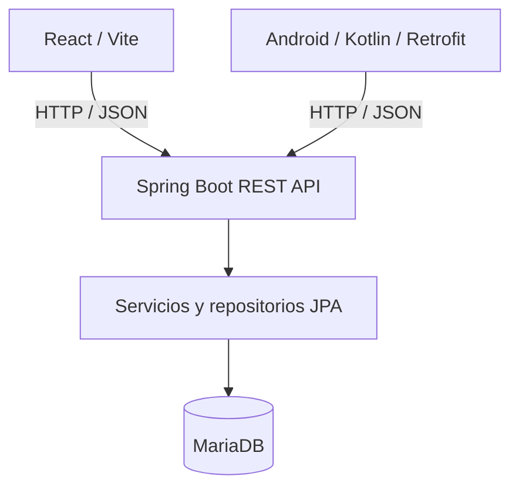

En Android se utiliza MVVM para la gestión de personajes:

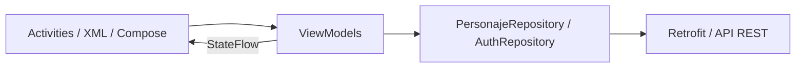

#### Activities de Android

| Activity | Interfaz / UI | Función / Feature | Requiere sesión / Authentication required |
| --- | --- | --- | --- |
| `MainActivity` | XML Views | Inicio de sesión / Login | No |
| `RegistroActivity` | XML Views | Registro / Registration | No |
| `BibliotecaActivity` | XML Views | Biblioteca personal y pública / Personal and public library | Sí / Yes |
| `DetallePersonajeActivity` | XML Views | Ficha y retrato / Character details and portrait | Sí / Yes |
| `PersonajeActivity` | Jetpack Compose | Creación y edición / Creation and editing | Sí / Yes |

### 5. Tecnologías

| Área | Herramientas |
| --- | --- |
| Web | React, Vite, JavaScript, CSS, i18next |
| Android | Kotlin, XML Views, Jetpack Compose, RecyclerView, Retrofit, Coroutines, StateFlow |
| Backend | Java, Spring Boot, Maven, Spring Data JPA, Hibernate |
| Persistencia | MariaDB, SQL, ORM |
| Calidad | Android Lint, Lighthouse, validaciones y pruebas funcionales |
| Control de versiones | Git, GitHub |

### 6. Instalación y ejecución local

#### Requisitos previos

- Git, Node.js y npm.
- JDK compatible con la configuración Maven del backend.
- MariaDB y un cliente SQL.
- Android Studio, Android SDK y un emulador o dispositivo Android.

#### Base de datos

1. Crear la base de datos `umbra` en MariaDB.
2. Importar el script SQL actualizado del proyecto.
3. Configurar la conexión del backend en `application.properties` o mediante la configuración externa correspondiente. No publicar contraseñas ni credenciales reales.

#### Backend

```bash
git clone -b develop https://github.com/Ixf2/UmbraBackendJoanaRam-rez.git
cd UmbraBackendJoanaRam-rez
```

Abrir el proyecto Maven en el IDE, configurar la conexión a MariaDB y ejecutar `UmbraBackendApplication`. Si el proyecto incluye Maven Wrapper, también se puede ejecutar `./mvnw spring-boot:run` (en Windows, `.\mvnw.cmd spring-boot:run`). Con Maven instalado, utilizar `mvn spring-boot:run`.

La configuración local utilizada durante el desarrollo emplea el puerto `8080`.

#### Aplicación web

```bash
git clone -b develop https://github.com/Ixf2/UMBRAJoanaRamirez.git
cd UMBRAJoanaRamirez
npm install
npm run dev
```

Abrir la URL que muestra Vite en la terminal y comprobar que la configuración de la API apunta al backend en ejecución.

#### Aplicación Android

```bash
git clone -b develop https://github.com/Ixf2/UMBRAAndroid.git
```

1. Abrir el proyecto con Android Studio y sincronizar Gradle.
2. Iniciar el backend y MariaDB.
3. Iniciar el emulador o conectar el dispositivo mediante ADB.
4. Para la configuración local usada en el proyecto, ejecutar:

```bash
adb devices
adb reverse tcp:8080 tcp:8080
adb reverse --list
```

La URL base de Retrofit en ese entorno es `http://127.0.0.1:8080/`. El comando requiere que ADB esté disponible y el dispositivo conectado. Ejecutar la aplicación desde Android Studio.

Si ADB no está en el PATH de Windows y el SDK está en su ubicación predeterminada, utilizar PowerShell:

```powershell
& "$env:LOCALAPPDATA\Android\Sdk\platform-tools\adb.exe" devices
& "$env:LOCALAPPDATA\Android\Sdk\platform-tools\adb.exe" reverse tcp:8080 tcp:8080
& "$env:LOCALAPPDATA\Android\Sdk\platform-tools\adb.exe" reverse --list
```

Opcionalmente, configurar una herramienta externa en Android Studio (Settings → Tools → External Tools), con `adb.exe` como programa y `reverse tcp:8080 tcp:8080` como argumentos. Añadirla a Before Launch de la configuración de ejecución, asegurándose de que el emulador ya está iniciado. Si falla, ejecutar el comando manualmente después de arrancar el emulador. El backend debe ejecutarse en el mismo equipo o máquina virtual que el servidor ADB.

*Nota sobre el entorno ISARD:* El proyecto se ha desarrollado y probado utilizando una máquina virtual Windows alojada en ISARD. Debido a la configuración de red del entorno virtualizado, se ha utilizado ADB Reverse para establecer la comunicación entre el emulador Android y el backend Spring Boot. Esta solución evita depender de una dirección IP específica de la máquina virtual, facilitando la ejecución del proyecto en otros equipos.

### 7. Capturas del proyecto

Las capturas Android se encuentran referenciadas mediante rutas relativas a `docs/images/android/` desde la raíz del repositorio. Las evidencias web y backend se incorporarán cuando estén disponibles.


#### Aplicación web

<!--


-->


#### Aplicación Android

##### Autenticación y registro / Authentication and registration

<p align="center">
  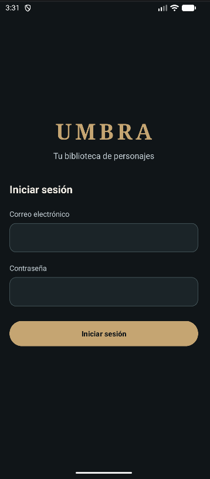
  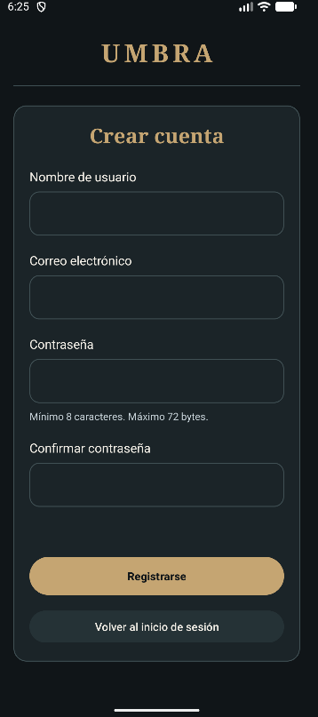
</p>

##### Biblioteca personal y pública / Personal and public library

<p align="center">
  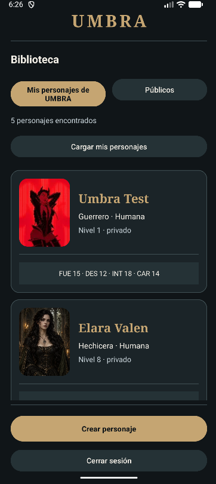
  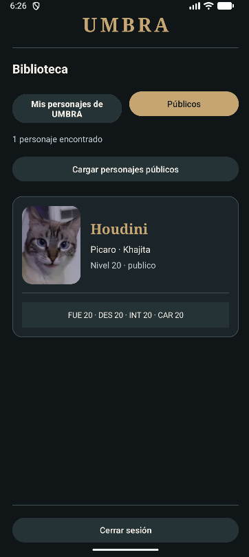
</p>

##### Creación y generación / Creation and generation

<p align="center">
  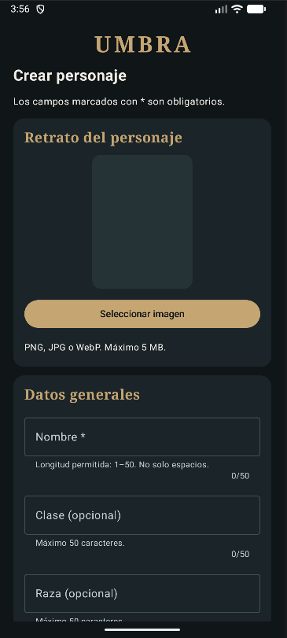
  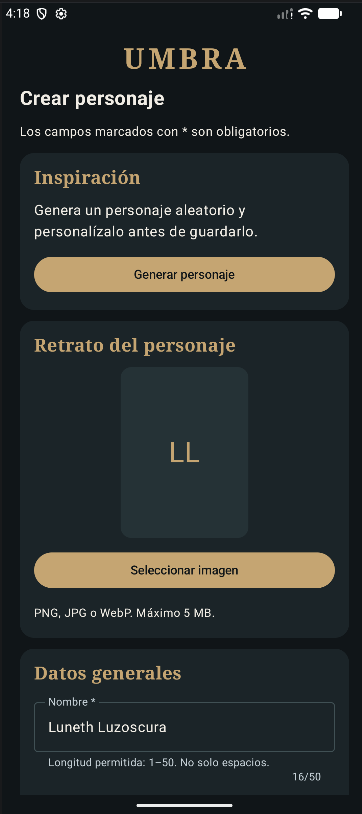
</p>

##### Formulario cumplimentado / Completed form

<p align="center">
  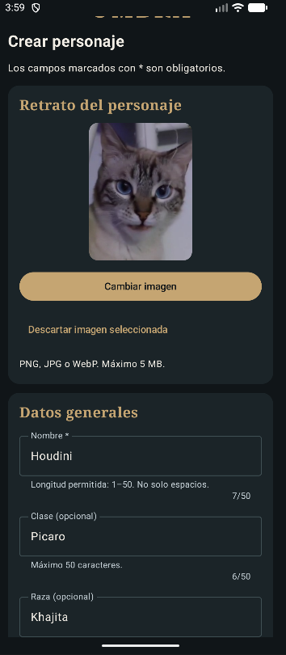
  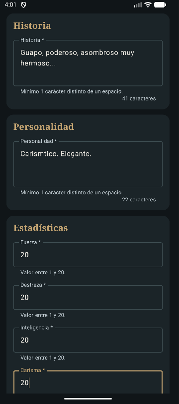
  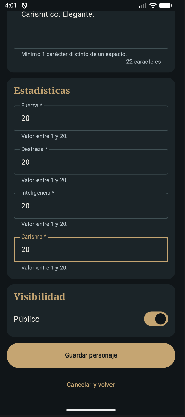
</p>

<p align="center">
  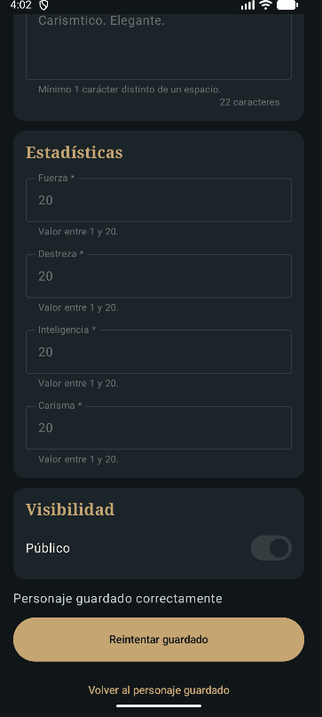
  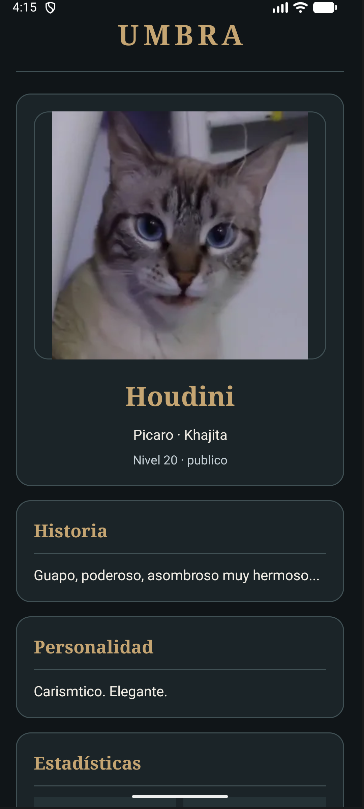
  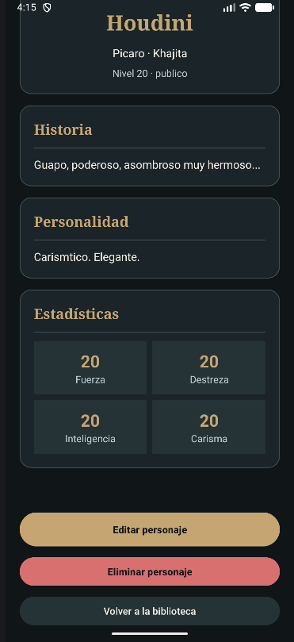
</p>

##### Edición y eliminación / Editing and deletion

<p align="center">
  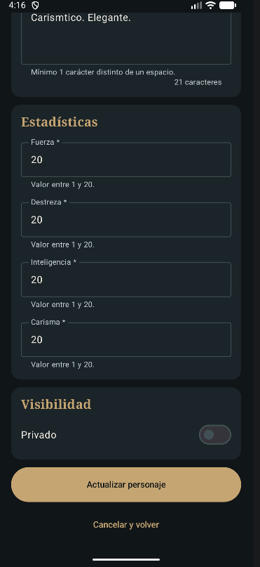
  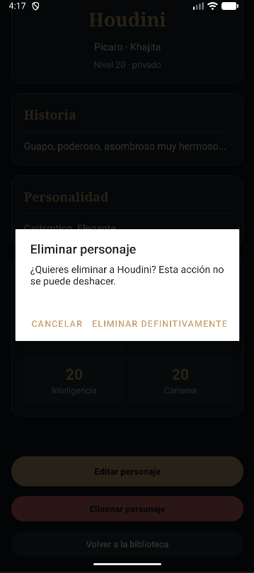
</p>


#### Backend y base de datos

<!--


-->


### 8. Calidad, seguridad y sostenibilidad

- Separación de responsabilidades entre interfaz, lógica y persistencia.
- Validaciones de entrada y control de acceso a operaciones sobre personajes.
- Procesamiento de retratos en el backend: dos versiones WebP almacenadas en `imagen_personaje` (miniatura de hasta 50 KiB y detalle de hasta 250 KiB).
- Spring Security exige autenticación para consultar personajes e imágenes, incluso públicos. Registro e inicio de sesión siguen abiertos.
- Pruebas sin credenciales: cuatro endpoints de personajes e imágenes devolvieron HTTP 401 el 28/11/2026.
- Auditorías con Lighthouse y Android Lint.
- Recursos de texto Android centralizados y uso de plurales.

Las pruebas finales de integración, permisos y rendimiento forman parte de la revisión previa a la entrega. El HTTP local se utiliza para desarrollo; un despliegue público requiere HTTPS y una configuración segura de credenciales.

<!-- Evidencias de calidad / Quality evidence:


-->

### 9. Estado y autoría

Proyecto académico en desarrollo. Rama de trabajo: `develop`.

**Estado al 28/11/2026:** Android incorpora el registro de usuarios y las bibliotecas personal y pública, además del CRUD, imágenes y generador. Pendientes la auditoría final de Lint y la revisión integral de registro, permisos e integración entre plataformas. En React queda pendiente corregir el guardado de retratos desde Inspiración. La revisión de CSRF y HTTPS sigue pendiente para producción.

**Autora:** Joana del Pino Ramírez García — [GitHub: Ixf2](https://github.com/Ixf2).

**Formación:** 2.º DAM · IES El Rincón · 2026–2027.

---

## English

### 1. Overview

UMBRA is a cross-platform application for creating, managing and browsing roleplaying characters. Users can organise character sheets in a personal library, develop backstories and personalities, define statistics and manage character visibility.

It is developed as an interdisciplinary academic project for the second year of the Higher Vocational Training programme in Multiplatform Application Development (DAM), academic year 2026–2027, at IES El Rincón.

### 2. Features

- User registration from Android, with username, email, password and password confirmation validation.
- Login and logout through Spring Security; authentication is required to browse public or private characters.
- Tab-based personal and public libraries: manage owned characters and browse public characters from other registered users.
- The public tab is read-only; editing and deletion are available in the personal library and subject to server-side authorisation.
- Android session verification through `SessionManager` and non-exported internal activities.
- Random character generator on Android: editable names, classes, races, origins, backstories, personalities, levels, traits and statistics.
- PNG, JPEG or WebP portrait selection from the device (up to 5 MiB), preview and replacement.
- Library thumbnails and higher-resolution detail portraits stored as binary WebP images in MariaDB.
- Create, read, update and delete characters (CRUD).
- Character names, backstories, personalities, classes, races, origins, levels and statistics.
- Public or private visibility and character access permissions.
- Responsive web interface with Spanish and English language support.
- Native Android application with five Activities: four using XML Views and one using Jetpack Compose.
- Form validation, loading states and error messages.

The project roadmap also includes settings, notifications and character-sharing features. Availability depends on the implementation status of each client.

### 3. Repositories

| Component | Technology | Repository |
| --- | --- | --- |
| Web application | React, Vite | [UMBRA Web](https://github.com/Ixf2/UMBRAJoanaRamirez/tree/develop) |
| Mobile application | Kotlin, Android Studio | [UMBRA Android](https://github.com/Ixf2/UMBRAAndroid/tree/develop) |
| Backend | Java, Spring Boot, Maven | [UMBRA Backend](https://github.com/Ixf2/UmbraBackendJoanaRam-rez/tree/develop) |
| Database | MariaDB, SQL | [SQL script `umbra`](https://drive.google.com/file/d/1jVAfkBek3cXsasbAn0mDg8_ejbLLUk1e/view?usp=sharing) |

### 4. Architecture

The web and Android clients communicate with a shared REST API. Spring Boot centralises business logic and database access through Spring Data JPA and Hibernate.

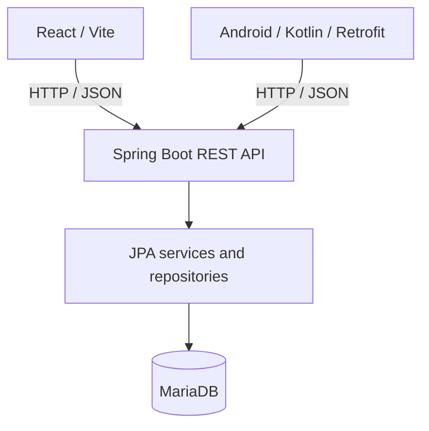

Android character management follows the MVVM pattern:

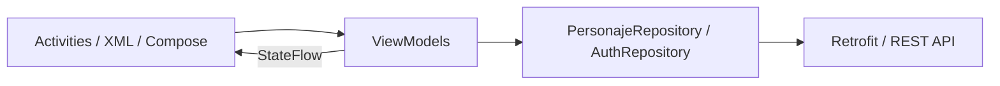

#### Android Activities

| Activity | Interfaz / UI | Función / Feature | Requiere sesión / Authentication required |
| --- | --- | --- | --- |
| `MainActivity` | XML Views | Inicio de sesión / Login | No |
| `RegistroActivity` | XML Views | Registro / Registration | No |
| `BibliotecaActivity` | XML Views | Biblioteca personal y pública / Personal and public library | Sí / Yes |
| `DetallePersonajeActivity` | XML Views | Ficha y retrato / Character details and portrait | Sí / Yes |
| `PersonajeActivity` | Jetpack Compose | Creación y edición / Creation and editing | Sí / Yes |

### 5. Technology stack

| Area | Tools |
| --- | --- |
| Web | React, Vite, JavaScript, CSS, i18next |
| Android | Kotlin, XML Views, Jetpack Compose, RecyclerView, Retrofit, Coroutines, StateFlow |
| Backend | Java, Spring Boot, Maven, Spring Data JPA, Hibernate |
| Persistence | MariaDB, SQL, ORM |
| Quality | Android Lint, Lighthouse, validation and functional testing |
| Version control | Git, GitHub |

### 6. Local installation and setup

#### Prerequisites

- Git, Node.js and npm.
- A JDK compatible with the backend Maven configuration.
- MariaDB and an SQL client.
- Android Studio, Android SDK and an emulator or Android device.

#### Database

1. Create the `umbra` database in MariaDB.
2. Import the current project SQL script.
3. Configure the backend database connection in `application.properties` or the appropriate external configuration. Never publish real passwords or credentials.

#### Backend

```bash
git clone -b develop https://github.com/Ixf2/UmbraBackendJoanaRam-rez.git
cd UmbraBackendJoanaRam-rez
```

Open the Maven project in your IDE, configure the MariaDB connection and run `UmbraBackendApplication`. If Maven Wrapper is included, use `./mvnw spring-boot:run` (Windows: `.\mvnw.cmd spring-boot:run`). Alternatively, with Maven installed, use `mvn spring-boot:run`.

The local development configuration uses port `8080`.

#### Web application

```bash
git clone -b develop https://github.com/Ixf2/UMBRAJoanaRamirez.git
cd UMBRAJoanaRamirez
npm install
npm run dev
```

Open the URL displayed by Vite and verify that the API configuration points to the running backend.

#### Android application

```bash
git clone -b develop https://github.com/Ixf2/UMBRAAndroid.git
```

1. Open the project in Android Studio and synchronise Gradle.
2. Start the backend and MariaDB.
3. Start the emulator or connect an Android device using ADB.
4. For the project's local development setup, run:

```bash
adb devices
adb reverse tcp:8080 tcp:8080
adb reverse --list
```

The Retrofit base URL in this environment is `http://127.0.0.1:8080/`. ADB must be available and the device connected. Run the application from Android Studio.

If ADB is not on the Windows PATH and the SDK is installed in its default location, use PowerShell:

```powershell
& "$env:LOCALAPPDATA\Android\Sdk\platform-tools\adb.exe" devices
& "$env:LOCALAPPDATA\Android\Sdk\platform-tools\adb.exe" reverse tcp:8080 tcp:8080
& "$env:LOCALAPPDATA\Android\Sdk\platform-tools\adb.exe" reverse --list
```

Optionally, configure an external tool in Android Studio (Settings → Tools → External Tools), using `adb.exe` as the program and `reverse tcp:8080 tcp:8080` as its arguments. Add it to the run configuration's Before Launch tasks, with the emulator already running. If it fails, run the command manually after starting the emulator. The backend must run on the same host or virtual machine as the ADB server.

*ISARD environment note:* Development and testing were carried out in a Windows virtual machine hosted on ISARD. ADB Reverse connects the Android emulator to Spring Boot without depending on a fixed virtual machine IP address.

### 7. Project screenshots

The screenshots are shared between both language sections. See [the screenshot gallery](#7-capturas-del-proyecto). The Android gallery uses relative paths under `docs/images/android/`. Web and backend screenshots will be added when available.

### 8. Quality, security and sustainability

- Separation of concerns between the interface, business logic and persistence.
- Input validation and access control for character operations.
- Server-side portrait processing: two WebP variants stored in `imagen_personaje` (thumbnail up to 50 KiB and detail up to 250 KiB).
- Spring Security requires authentication for character and image requests, including public characters. Registration and login remain open.
- Anonymous-access tests: four character and image endpoints returned HTTP 401 on 28 November 2026.
- Lighthouse and Android Lint audits.
- Centralised Android text resources and plural handling.

Final integration, permission and performance tests are part of the pre-delivery review. Local HTTP is used for development only; public deployment requires HTTPS and secure credential configuration.

### 9. Project status and author

Academic project under development. Working branch: `develop`.

**Status as of 28 November 2026:** Android includes user registration and personal and public libraries, in addition to CRUD, images and the generator. The final Lint audit and full registration, permissions and cross-platform integration review remain pending. React Inspiration portrait persistence still needs fixing. CSRF and HTTPS remain production-security review items.

**Author:** Joana del Pino Ramírez García — [GitHub: Ixf2](https://github.com/Ixf2).

**Programme:** Second-year DAM · IES El Rincón · 2026–2027.

---

<p align="center"><strong>UMBRA</strong> · Create. Explore. Imagine.</p>
